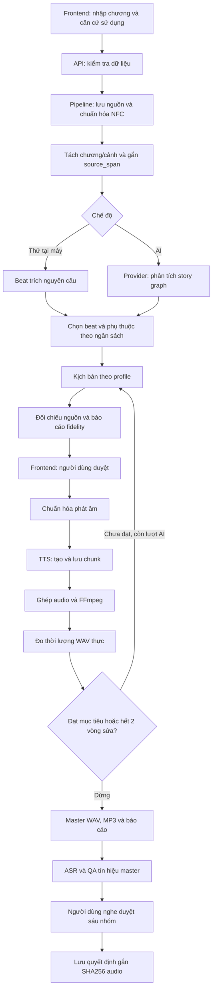

# Kiến trúc và quy trình dự án

Ứng dụng tách frontend, backend, kiểm tra, tài liệu và dữ liệu chạy. Hiện dùng Python cùng HTML/CSS/JavaScript thuần; frontend và API được phục vụ trên một địa chỉ loopback để không cần thêm máy chủ phát triển hoặc cấu hình CORS.

## Trách nhiệm của từng phần

| Thành phần | Trách nhiệm |
|---|---|
| `frontend/index.html` | Cấu trúc trang, biểu mẫu và vùng kết quả |
| `frontend/css/styles.css` | Giao diện, responsive và trạng thái hiển thị |
| `frontend/js/app.js` | Gọi API, theo dõi tác vụ, đối chiếu nguồn, tải và phát audio |
| `backend/server.py` | Kiểm tra HTTP, điều phối tác vụ nền, lịch sử, tải artifact và phục vụ tài nguyên frontend |
| `backend/config.py` | Xác định đường dẫn tuyệt đối từ vị trí mã nguồn |
| `backend/errors.py` | Phân biệt lỗi đầu vào với lỗi dịch vụ |
| `backend/providers.py` | HTTP, xác thực bằng biến môi trường, đọc phản hồi AI |
| `backend/services/pipeline.py` | Chương/cảnh có giới hạn ngữ cảnh, source span, graph, kế hoạch và fidelity; ứng viên sửa thời lượng |
| `backend/services/pronunciation.py` | Chuẩn hóa lời đọc, từ điển và trường hợp chưa rõ |
| `backend/services/audio.py` | Chunk TTS, cache, FFmpeg, đo/sửa thời lượng; staging và rollback artifact |
| `backend/services/qa.py` | ASR/CER/WER, PCM, loudness/true peak, quyền sử dụng và nghe duyệt |
| `tests/check.py` | Chạy các check thành phần và kiểm tra API với AI/TTS/ASR giả |
| `storage/projects/<id>/` | Lưu nguồn và kết quả theo từng dự án |

## Quy trình xử lý

AI viết và đối chiếu riêng cho từng phần của mỗi profile. Nguồn mỗi phần khoảng 8.000 ký tự, ngữ cảnh nối phần tối đa 1.600 ký tự; liên hệ xa cần người duyệt. Chế độ thử trích câu, chưa kiểm định ngữ nghĩa. Tồn tại dẫn chứng không tự bảo đảm đúng nghĩa.

## Luồng dữ liệu

Frontend gọi API bằng đường dẫn tương đối `/api/...`; không truy cập trực tiếp filesystem hoặc giữ API key. Backend nhận cấu hình dịch vụ từ biến môi trường. Các dịch vụ xử lý không phụ thuộc HTTP handler và ghi artifact vào thư mục dự án được truyền vào.

`storage/projects/<id>/` giữ nguồn, graph, kịch bản và báo cáo. Mỗi profile có thư mục riêng cho văn bản, chunk, WAV và MP3. `storage/logs/` chứa log khi chạy nền; chạy trực tiếp mặc định ghi ra terminal. `storage/tests/` chứa thư mục tạm được kiểm tra tự động dọn sau khi xác minh đường dẫn.

`backend/config.py` xác định đường dẫn từ file mã nguồn, không dựa vào thư mục làm việc hiện tại. Lệnh `python -m backend` được chạy từ gốc repository để Python nhận diện package. Tài nguyên frontend được phục vụ bằng danh sách đường dẫn cho phép; các thư mục backend, docs và storage không được công khai như thư mục web.

## Phạm vi hiện tại

Ứng dụng xử lý một công việc mỗi lần, tối đa 1.000.000 ký tự và một giọng TTS. Chia cảnh theo tiêu đề/dấu ngăn/kích thước, chưa suy ra chuyển cảnh ngữ nghĩa. Tự sửa thời lượng tối đa hai lần có kiểm định; ASR cần gateway và ngưỡng nội bộ. QA chưa đủ dữ liệu không được duyệt cuối. Không có chức năng phát hành tự động. Xem [quy trình QA](qa.md).
