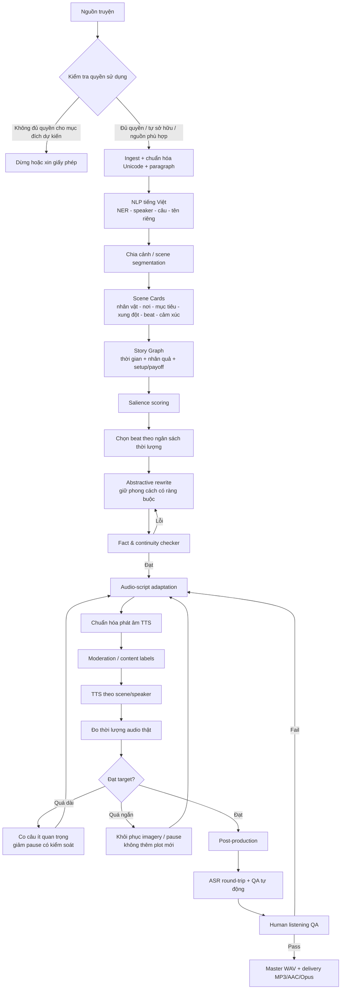
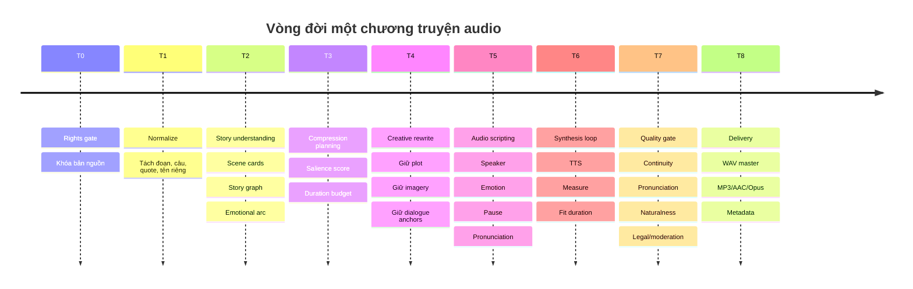
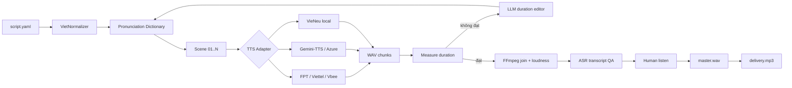

# Phương pháp chuyển chương truyện chữ dài thành truyện audio ngắn bằng AI với giọng tiếng Việt

## Tóm tắt điều hành

Mục tiêu “rút ngắn nhưng vẫn giữ tinh hoa” không nên được triển khai như một bài toán **tóm tắt văn bản một bước**. Với truyện, thứ cần bảo toàn không chỉ là thông tin, mà còn gồm quan hệ nhân quả, nhịp tiết lộ, cao trào, hình ảnh đặc trưng, lời thoại có sức nặng và đường cong cảm xúc. Nghiên cứu về tóm tắt tài liệu dài cho thấy cách chia nhỏ rồi tóm tắt phân cấp là thực dụng, nhưng việc liên tục tóm tắt trên chính các bản tóm tắt có thể khuếch đại sai lệch/hallucination; vì vậy pipeline nên luôn giữ liên kết ngược về văn bản nguồn. citeturn21search3turn26search2

**Kiến trúc tôi khuyến nghị là “StoryGraph → Budgeted Compression → Audio Script → Duration Feedback → TTS → QA”**, gồm ba lớp:

1. **Lớp hiểu truyện:** chia cảnh, xác định nhân vật, thời gian/không gian, mục tiêu–xung đột–bước ngoặt, quan hệ nhân quả, lời thoại then chốt, hình ảnh và đường cong cảm xúc.
2. **Lớp biên tập:** tính độ quan trọng của từng “story beat”, chọn beat dưới ngân sách thời lượng, rồi viết lại có ràng buộc phong cách. Không cho mô hình tự phát minh sự kiện để nối mạch.
3. **Lớp audio:** chuyển bản biên tập thành kịch bản TTS có narrator/speaker/emotion/pause, tổng hợp thử, **đo thời lượng audio thật**, rồi tự động co/giãn kịch bản đến khi đạt thời lượng.

Đối với tiếng Việt, preprocessing nên tách riêng **NLP văn học** và **text normalization cho TTS**. VnCoreNLP hỗ trợ word segmentation, POS, NER và dependency parsing cho tiếng Việt; VietNormalizer, công bố năm 2026, xử lý các dạng gây lỗi đọc như số, ngày giờ, tiền tệ, phần trăm, viết tắt và từ vay mượn trước khi đưa vào TTS. citeturn26search0turn26search1

Về TTS, ở thời điểm **24/10/2026**, lựa chọn đáng thử nghiệm nhất chia thành ba nhóm. **FPT.AI/Viettel AI/Vbee** phù hợp khi ưu tiên giọng Việt và triển khai trong nước; **Google Gemini-TTS/Chirp 3 và Azure Speech** mạnh về API, điều khiển prosody/emotion và hạ tầng; **VieNeu-TTS v3 Turbo** đáng chú ý nếu muốn self-host/open source: model card hiện công bố giấy phép Apache-2.0, 48 kHz, 23 giọng preset Bắc–Trung–Nam, voice cloning, streaming API và emotion cues. citeturn24view0turn23search1turn25search14turn25search0turn24view4turn25search15

**Các mặc định kỹ thuật nên bắt đầu như sau, nhưng không coi chúng là tiêu chuẩn bắt buộc:**

| Tham số | Khuyến nghị khởi đầu |
|---|---|
| `target_duration` | **không xác định** nếu người dùng không cung cấp |
| Khi `target_duration` không xác định | xuất 3 profile: Giữ nhiều / Cân bằng / Rút mạnh |
| Tỉ lệ cắt mặc định | 25–35% / 45–60% / 65–80%, tùy profile |
| Ưu tiên giữ plot | rất cao, khoảng `0.95` |
| Ưu tiên lời thoại then chốt | cao, khoảng `0.75–0.90` |
| Ưu tiên miêu tả giàu hình ảnh | trung bình–cao, khoảng `0.55–0.75` |
| Ưu tiên exposition lặp lại | thấp, khoảng `0.20–0.45` |
| Dung sai thời lượng sau TTS | đề xuất ±3–5% |
| Master audio | WAV PCM, mono, 48 kHz, 24-bit nếu pipeline hỗ trợ |
| Phân phối | MP3 96–128 kbps mono; hoặc AAC/Opus tương đương |
| `max_file_duration` | **không xác định** nếu chưa biết nền tảng phát hành |
| Default vận hành | chia file theo cảnh/chương, đề xuất ≤15–30 phút/file |
| Loudness | dùng một target nội bộ nhất quán; có thể chuẩn hóa bằng FFmpeg `loudnorm` |
| Peak ceiling | đề xuất ≤ −1 dBTP |

FFmpeg cung cấp resampling và bộ lọc `loudnorm`; Audacity cho phép chọn sample rate/bitrate khi xuất MP3 và có Loudness Normalization dựa trên nguyên tắc EBU R128. citeturn17search0turn17search1turn17search5

## Kiến trúc và quy trình end-to-end

Điểm quan trọng nhất là **không gửi cả chương truyện cho LLM với một câu “hãy tóm tắt còn 6 phút”**. Cách đó khó kiểm soát việc mất setup/payoff, đổi tính cách nhân vật, bỏ câu thoại then chốt hoặc làm nhịp truyện phẳng. Pipeline nên có trạng thái trung gian có cấu trúc.



**Timeline logic**, không gán thời gian xử lý giả định vì tốc độ phụ thuộc độ dài chương, model, GPU/API và số vòng sửa:



Quy trình chi tiết nên vận hành như sau.

| Bước | Thực hiện | Artifact bắt buộc | Gate trước khi đi tiếp |
|---|---|---|---|
| Thu thập | Nhập TXT/DOCX/EPUB/HTML; lưu source ID, chapter ID, quyền sử dụng, tác giả/chủ sở hữu | `source.json`, raw text | Nguồn không bị thiếu/trùng; rights status rõ |
| Làm sạch | Unicode NFC, sửa OCR nếu có, giữ nguyên dấu ngoặc thoại, xuống dòng, dấu ba chấm | `clean.txt` | Không làm mất ranh giới lời thoại |
| NLP | Sentence/paragraph split; NER; nhận biết nhân vật và speaker; chuẩn hóa tên gọi | `entities.json` | Một nhân vật không bị tách thành nhiều entity |
| Chia cảnh | Cắt theo thay đổi nơi/thời gian/POV/mục tiêu hoặc transition | `scene_cards.json` | Mỗi scene có đầu–giữa–điểm thay đổi rõ |
| Phân tích plot | Tạo beat, setup/payoff, bí mật, conflict, causal edge | `story_graph.json` | Không tồn tại payoff mà setup bị thất lạc |
| Lập ngân sách | Tính trọng số beat + ngân sách từ/thời gian | `compression_plan.json` | Tất cả must-have beats được giữ |
| Viết tóm tắt sáng tạo | Viết theo scene plan, không theo trí nhớ model | `summary_v1.txt` | Không thêm nhân vật/sự kiện mới |
| Kiểm tra đối chiếu | QA từng claim với source span | `fidelity_report.json` | 0 lỗi plot nghiêm trọng |
| Audio adaptation | Câu ngắn hơn, speaker tags, pause/emotion/SFX | `script.yaml` | Nghe được bằng tai, không chỉ “đọc được” |
| Duration fit | TTS nháp → đo duration → sửa budget | `duration_report.json` | Trong tolerance |
| Moderation | Gắn nhãn violence/sexual/self-harm/hate/minor/privacy… tùy nền tảng | `safety.json` | Đúng chính sách phát hành |
| TTS | Render theo scene/speaker, giữ seed/config nếu model có | WAV chunks | Không lỗi phát âm/click/clipping |
| Hậu kỳ | nối scene, loudness, silence, ambience/music có quyền | Master | Continuity âm thanh đạt |
| QA | ASR round-trip + nghe người thật | QA report | Đạt ngưỡng trước publish |

**Scene Card** là cấu trúc trung gian quan trọng nhất. Một mẫu đủ dùng:

```json
{
  "scene_id": "S04",
  "location": "bến sông",
  "time": "đêm",
  "characters": ["Lâm", "Hạnh"],
  "goal": "Hạnh cần Lâm xác nhận nguồn gốc chiếc chuông",
  "conflict": "Lâm né tránh quá khứ",
  "revelation": "Lâm là người cuối cùng kéo chuông trong đêm lũ",
  "causes": ["S02", "S03"],
  "payoffs": ["S06"],
  "must_keep_facts": [
    "bác Phúc đã cứu Lâm",
    "cha Hạnh mất trong trận lũ",
    "bến sẽ bị tháo"
  ],
  "imagery_anchors": [
    "đèn dầu",
    "bãi cát",
    "chuông đồng xanh rêu"
  ],
  "dialogue_anchors": [
    "Anh vẫn giỏi nói câu hợp lý.",
    "Anh chỉ nợ chính anh một lần quay lại nhìn cho rõ."
  ],
  "emotion_in": "xa cách",
  "emotion_out": "đối diện quá khứ"
}
```

Đối với chương rất dài, nên dùng **hierarchical processing nhưng source-grounded**: chunk → scene card → graph → synthesis. mLongT5 được thiết kế cho đầu vào dài và đa ngôn ngữ, trong khi PEGASUS là kiến trúc encoder–decoder được pretrain bằng gap-sentence generation riêng cho abstractive summarization. Hai loại model này phù hợp làm baseline/self-host; với production hiện nay, LLM đa ngôn ngữ có structured output thường thuận lợi hơn cho bước scene extraction và constrained rewriting. citeturn26search2turn26search3

## Thuật toán AI, kiểm soát phong cách và tham số kỹ thuật

Một hệ thống tốt nên phân biệt **“chọn nội dung nào được sống sót”** với **“viết nội dung đó thế nào”**. Nếu để cùng một generation call làm cả hai, model rất dễ hy sinh plot để đổi lấy văn phong trôi chảy.

**Kiến trúc đề xuất cho từng tầng:**

| Tầng | Kiến trúc/thuật toán | Vì sao phù hợp |
|---|---|---|
| Tách câu, NER, parse | VnCoreNLP + rule cho dấu ngoặc thoại | Tối ưu cho cấu trúc tiếng Việt; VnCoreNLP có segmentation, POS, NER, dependency parsing. citeturn26search0 |
| Tách scene | Embedding change-point + LLM classifier | Kết hợp signal lexical với hiểu ngữ nghĩa |
| Entity/coreference | NER + alias table + LLM resolver | Truyện thường gọi cùng người bằng tên, chức danh, đại từ |
| Plot extraction | LLM structured JSON → temporal/causal graph | Cho phép kiểm tra setup/payoff và contradiction |
| Salience | weighted scoring + graph centrality | Không chỉ dựa vào “câu nổi bật” |
| Chọn beat | 0/1 knapsack hoặc constrained optimizer | Fit đúng budget nhưng vẫn giữ must-have |
| Abstractive summary | mLongT5/PEGASUS baseline hoặc long-context LLM | mLongT5 xử lý chuỗi dài đa ngôn ngữ; PEGASUS được thiết kế cho summarization. citeturn26search2turn26search7 |
| Giữ phong cách | style fingerprint + constrained generation + style critic | Tránh sao chép máy móc, vẫn giữ POV/register/nhịp |
| Kiểm tra fidelity | source retrieval + NLI/LLM judge + deterministic entity checks | Mọi sự kiện quan trọng phải truy được về nguồn |
| Duration control | text estimate → actual TTS duration feedback | Tốc độ đọc thực thay đổi theo dấu câu, giọng, cảm xúc |
| TTS normalization | VietNormalizer + pronunciation lexicon | Xử lý số, ngày, tiền, %, acronym, loanword trước TTS. citeturn26search1 |
| Emotion/prosody | scene-level emotion planner → prompt/SSML/provider parameters | Không nên gán một cảm xúc duy nhất cho cả chương |
| Audio QA | ASR round-trip + acoustic checks + MOS human | MOS là khái niệm chuẩn dùng trong đánh giá chất lượng thoại. citeturn21search4 |

Một hàm chấm **độ quan trọng của story beat** có thể triển khai:

\[
S_i =
0.30P_i +
0.22C_i +
0.18E_i +
0.12D_i +
0.10I_i +
0.08F_i
\]

Trong đó:

- \(P\): plot necessity — bỏ beat có làm cốt truyện không hiểu được không?
- \(C\): causal centrality — beat là nguyên nhân/kết quả của bao nhiêu beat khác?
- \(E\): emotional importance.
- \(D\): giá trị của lời thoại.
- \(I\): imagery — hình ảnh đặc trưng giúp giữ “hồn truyện”.
- \(F\): foreshadow/payoff value.

Đây là **hàm khởi tạo do báo cáo đề xuất**, không phải một tiêu chuẩn học thuật. Sau khi thu thập dữ liệu QA thật, trọng số nên được học bằng pairwise preference/ranking model thay vì cố định.

Đặt các beat không được phép xóa bằng:

```text
must_keep = (
    inciting_incident
    OR climax
    OR resolution
    OR required_setup_for_retained_payoff
    OR required_payoff_for_retained_setup
)
```

Sau đó giải bài toán:

\[
\max \sum_i S_i x_i
\]

với:

\[
\sum_i cost_i x_i \leq B
\]

và:

\[
x_i=1\quad\forall i\in must\_keep
\]

`cost_i` có thể là số từ dự kiến hoặc **số giây TTS ước tính**, còn `B` là ngân sách thời gian.

**Thời lượng mục tiêu** phải được định nghĩa chính xác như user yêu cầu:

```yaml
target_duration_minutes: null   # "không xác định"
```

Khi `target_duration_minutes = null`, không nên tự giả định “5 phút”. Hệ thống nên trả về các phương án:

| Mode | Phần nội dung giữ lại, khởi tạo | Tỉ lệ cắt khởi tạo | Trường hợp |
|---|---:|---:|---|
| `preserve` | 65–75% | 25–35% | Truyện giàu văn chương, cần giữ không khí |
| `balanced` | 40–55% | 45–60% | Audio recap/chương ngắn |
| `compact` | 20–35% | 65–80% | Shorts/review cực ngắn |

Các tỷ lệ trên là **profile thiết kế**, không phải chuẩn ngành. Điều đúng hơn là để story density quyết định: một chương toàn hành động có thể chỉ cắt 30%, còn một chương có nhiều độc thoại lặp lại có thể cắt 60% mà vẫn giữ toàn bộ sự kiện.

Nếu có thời lượng \(D\), ước lượng ban đầu:

\[
W_{target}=D \times R \times (1-p)
\]

với `R` là tốc độ đọc chủ động và `p` là phần thời gian dành cho pause/SFX. Ví dụ với profile nội bộ `R = 145 đơn vị từ/phút`, `p = 0.08`, 6 phút cho ngân sách khoảng:

\[
6\times145\times0.92\approx800
\]

Tuy nhiên, tiếng Việt có vấn đề “từ” và “tiếng” không hoàn toàn tương ứng với token tách bằng khoảng trắng. Vì vậy đây chỉ là **ước lượng vòng đầu**. Vòng cuối luôn nên đo trực tiếp file TTS.

Thuật toán fit duration:

```python
target = target_duration_seconds

for iteration in range(max_iterations):
    audio = synthesize(script)
    actual = duration(audio)
    error = (actual - target) / target

    if abs(error) <= 0.03:
        break

    if error > 0:
        # Không xóa must_keep.
        # Ưu tiên nén exposition, description trùng ý,
        # rồi giảm pause không mang chức năng kịch tính.
        script = compress_low_salience(script, ratio=error)
    else:
        # Khôi phục imagery/dialogue từ source đã chọn.
        # Tuyệt đối không phát minh sự kiện mới.
        script = restore_source_grounded_material(script, ratio=-error)
```

**Giữ miêu tả và đối thoại** cũng nên trở thành tham số, thay vì prompt mơ hồ:

```yaml
retention:
  plot_facts: 0.95
  causal_links: 0.95
  dialogue_key_lines: 0.85
  dialogue_secondary: 0.55
  scenic_imagery: 0.70
  character_micro_actions: 0.55
  exposition_repeated: 0.25
  internal_monologue_repeated: 0.35

style:
  pov: preserve
  tense: preserve
  register: preserve
  regional_words: preserve_unless_tts_error
  sentence_rhythm: medium_high
  metaphor_density: medium_high
```

Các giá trị là **prior khởi đầu**, sau đó phải điều chỉnh theo thể loại. Truyện trinh thám phải đặt causal clue rất cao; romance cần micro-action và subtext cao hơn; kiếm hiệp/fantasy cần kiểm soát danh từ riêng và world-building.

Giữ phong cách hiệu quả nhất không phải là yêu cầu “viết y hệt tác giả X”, mà là tạo **style fingerprint** từ chính chương đầu vào:

```json
{
  "pov": "ngôi thứ ba giới hạn",
  "sentence_length": "trung bình, xen câu rất ngắn khi cao trào",
  "register": "văn học hiện đại, mộc",
  "dialogue": "ít lời, nhiều hàm ý",
  "imagery": ["ánh sáng", "nước", "mùi", "đồ vật cũ"],
  "metaphor_level": "vừa",
  "narrator_distance": "gần nhân vật chính",
  "forbidden_changes": [
    "không đổi POV",
    "không hiện đại hóa từ vựng",
    "không giải thích điều nguồn cố ý để mơ hồ"
  ]
}
```

Đánh giá tóm tắt không nên chỉ dựa vào ROUGE. BERTScore dùng biểu diễn ngữ cảnh để đo tương đồng semantic, nhưng với truyện vẫn cần kiểm tra plot/entity/causal chain bằng các test riêng; đặc biệt, nghiên cứu long-document summarization cũng cảnh báo recursive merging có thể tích lũy hallucination. citeturn22search0turn21search3

**Cấu hình audio đề xuất:**

| Thuộc tính | Master | Distribution |
|---|---|---|
| Container/codec | WAV PCM | MP3 / AAC / Opus |
| Channels | mono, trừ khi làm soundscape stereo | mono thường đủ cho narration |
| Sample rate | 48 kHz | 44.1 hoặc 48 kHz |
| Bit depth | 24-bit nếu hậu kỳ; 16-bit nếu source TTS chỉ hỗ trợ 16-bit | codec lossy không áp dụng bit depth tương tự PCM |
| MP3 bitrate | — | 96–128 kbps mono đề xuất |
| Opus | — | 64–96 kbps cho thoại đề xuất |
| Peak | ≤ −1 dBTP nội bộ | giữ giống master |
| File duration max | **không xác định** | nếu chưa có yêu cầu nền tảng, chia theo scene/chapter; mặc định vận hành 15–30 phút |
| Metadata | source/version/voice/model/license | title/chapter/author/AI disclosure nếu cần |

Audacity hỗ trợ cấu hình sample rate và bitrate khi export; FFmpeg phù hợp cho resampling, transcoding, nối chunk và loudness normalization trong pipeline không giao diện. citeturn17search1turn17search8turn17search16

## Công cụ, thư viện và TTS tiếng Việt nên ưu tiên

**NLP và orchestration.** Với preprocessing tiếng Việt, VnCoreNLP là lựa chọn thực dụng cho segmentation/NER/parser. Trước TTS, VietNormalizer là lớp bổ sung hợp lý để biến số, ngày tháng, tiền tệ, `%`, acronym và một số từ ngoại lai thành dạng dễ đọc hơn. citeturn26search0turn26search1

Với orchestration, **n8n** thuận lợi cho prototype/no-code vì HTTP Request node có thể gọi trực tiếp các REST API; **Apache Airflow** phù hợp hơn cho batch production có dependency, retry, scheduling và observability, trong đó workflow được biểu diễn dưới dạng DAG. citeturn17search2turn17search7turn17search23

Một stack cân bằng:

```text
Input
  → Python/FastAPI
  → VnCoreNLP
  → Scene/Story LLM
  → PostgreSQL / JSON artifacts
  → Summarization/rewriting LLM
  → VietNormalizer + custom pronunciation dictionary
  → TTS provider abstraction
  → FFmpeg
  → ASR QA
  → Object storage
  → n8n (small/medium) hoặc Airflow (large batch)
```

**TTS abstraction** nên tránh khóa cứng code theo một nhà cung cấp:

```python
class TTSRequest:
    text: str
    language: str = "vi-VN"
    voice: str | None = None
    speed: float | None = None
    emotion: str | None = None
    emotion_strength: float | None = None
    pitch: float | None = None
    pauses: list | None = None
    output_format: str = "wav"

class TTSProvider:
    def synthesize(self, request: TTSRequest) -> bytes:
        ...
```

Adapter sẽ map request chung sang `speed` của FPT, SSML của Azure, natural-language voice direction của Gemini-TTS hoặc inline cue của VieNeu.

### So sánh TTS tiếng Việt

Bảng dưới đây là **đánh giá kỹ thuật để shortlist**, không phải benchmark head-to-head độc lập. “Chất lượng” phản ánh mức phù hợp với audiobook dựa trên tính năng/capability công bố; nên A/B test bằng chính thể loại truyện của bạn trước khi ký hợp đồng.

| Giải pháp | Chất lượng cho truyện Việt | Điều khiển cảm xúc/prosody | Chi phí hiện tại / mô hình giá | API | Loại | Ngôn ngữ |
|---|---|---|---|---|---|---|
| **FPT.AI TTS** | Tốt, lợi thế giọng Bắc/Trung/Nam | Speed `-3…+3`; VoiceMaker có pause, dictionary và multi-voice; emotion granular kém prompt-TTS | 100.000 ký tự/tháng miễn phí được vendor công bố; vượt quota mua gói | REST; tối đa 5.000 ký tự/request; MP3/WAV | Thương mại | Tập trung mạnh tiếng Việt citeturn24view0turn23search0 |
| **Viettel AI TTS** | Tốt cho tiếng Việt, có giọng vùng miền | Có tính biểu cảm ở sản phẩm; nên test API vì tài liệu công khai ít granular hơn Gemini/Azure | Trang giá hiện có gói Basic khoảng 240.000₫ và cơ chế credit; vendor cũng công bố trial 50.000 ký tự cho tài khoản mới trong tài liệu 2025 | Có API | Thương mại | Tiếng Việt là trọng tâm citeturn23search1turn23search14turn23search8 |
| **Vbee AIVoice** | Tốt; phù hợp narration, có nhiều voice | Tùy biến từng câu, voice cloning; tài liệu API/vendor nêu style/tone | Freemium + paid/API; bảng giá hiện hành thay đổi theo gói | Có API TTS | Thương mại Việt Nam | Vendor công bố 50+ ngôn ngữ, 1000+ giọng citeturn25search5turn25search8turn25search14 |
| **Zalo AI** | Phù hợp tiếng Việt, accent/dialect là trọng tâm | Điều khiển emotion công khai ít chi tiết hơn các prompt-TTS mới | Theo plan/quota hiện hành của Zalo AI | Có TTS API | Thương mại | Tập trung tiếng Việt citeturn23search2turn24view1 |
| **Google Gemini-TTS** | Rất đáng thử cho audiobook có diễn xuất | Natural-language prompt điều khiển style, accent, pace, tone, emotion; single/multi-speaker | Gemini-TTS tính theo input/output token; bảng giá thay đổi theo model. Cloud pricing hiện niêm yết các mức riêng cho Gemini-TTS | Cloud TTS/Vertex REST + SDK | Thương mại | `vi-VN` hiện được hỗ trợ GA; nhiều ngôn ngữ khác citeturn23search6turn25search0turn23search3 |
| **Google Chirp 3 HD** | Cao cho narration sạch | Ít “prompt acting” hơn Gemini-TTS, nhưng chất lượng generative cao | Hiện Cloud pricing nêu 1M ký tự free, sau đó khoảng US$30/1M ký tự cho Chirp 3 HD | Streaming/batch | Thương mại | Có `vi-VN`; batch hỗ trợ MP3/OGG_OPUS/PCM… citeturn23search3turn25search16 |
| **Azure Speech** | Tốt, enterprise-ready | SSML có `style`, `styledegree` 0.01–2 và role **đối với subset giọng hỗ trợ**; pace/pitch/volume qua SSML | Free tier hiện nêu 0,5M neural characters/tháng; PAYG thay đổi theo model/region, trang giá hiện hiển thị khoảng US$15/1M chars cho một số Neural tier | REST/SDK/SSML | Thương mại | Azure TTS hỗ trợ `vi-VN`; multilingual voices cũng có tiếng Việt citeturn24view3turn24view4turn25search1turn25search7 |
| **VieNeu-TTS v3 Turbo** | Rất thú vị cho self-host; cần tự benchmark production | Inline emotion cues, voice cloning, nhiều preset vùng miền | Model OSS, chi phí là GPU/CPU vận hành | OpenAI-compatible API + Python/Docker | **Apache-2.0 OSS** | EN–VI; model card nêu 23 preset Bắc/Trung/Nam, 48 kHz citeturn25search15 |

FPT đáng chú ý ở tính đơn giản: API hiện tài liệu hóa rõ 7 voice code, `speed`, MP3/WAV, giới hạn **5.000 ký tự/request** và callback async. citeturn24view0 Google hiện đi xa hơn ở khía cạnh “đạo diễn giọng”: tài liệu Gemini-TTS mô tả điều khiển trực tiếp style, accent, pace, tone và cảm xúc bằng prompt, đồng thời hỗ trợ narrative dài và nhiều speaker; tiếng Việt `vi-VN` hiện nằm trong danh sách hỗ trợ. citeturn23search6turn25search0 Azure nằm giữa hai thái cực: SSML cho phép điều khiển rất có cấu trúc, nhưng Microsoft lưu ý style/role chỉ áp dụng với một subset các neural voice. citeturn24view4

Với open-source, VieNeu hiện thực dụng hơn nhiều dự án TTS Việt cũ nếu nhu cầu là self-host: model card công bố 48 kHz, 23 preset Bắc/Trung/Nam, CPU ONNX/GPU, streaming API tương thích OpenAI, voice cloning và emotion cues. Các benchmark/công bố hiệu năng trong model card vẫn là **self-reported**, vì vậy không nên dùng chúng thay cho A/B test nội bộ. citeturn25search15

**Shortlist triển khai thực tế:**

- Muốn **triển khai nhanh, Việt Nam, ít DevOps**: FPT.AI hoặc Viettel AI.
- Muốn **audiobook diễn xuất, prompt emotion mạnh**: Gemini-TTS.
- Muốn **enterprise + SSML deterministic**: Azure Speech.
- Muốn **self-host, kiểm soát dữ liệu/chi phí dài hạn**: VieNeu-TTS v3 Turbo.
- Muốn **hệ sinh thái Việt + voice cloning/multilingual UI**: Vbee.

Đó là shortlist kiến trúc, không phải xếp hạng tuyệt đối.

## Bản quyền, kiểm duyệt và các rủi ro pháp lý-kỹ thuật

Đây là phần cần đặt **trước** summarization chứ không phải sau khi audio đã hoàn tất.

Theo pháp luật sở hữu trí tuệ Việt Nam, tác phẩm văn học thuộc nhóm đối tượng được bảo hộ quyền tác giả; các quyền kinh tế bao gồm làm tác phẩm phái sinh, sao chép và truyền đạt tác phẩm tới công chúng. Luật sửa đổi năm 2022 và Nghị định 17/2023/NĐ-CP là những văn bản quan trọng hiện hành về quyền tác giả/quyền liên quan; Nghị định 17 cũng quy định điều kiện cho trường hợp “trích dẫn hợp lý”. citeturn18search0turn18search2turn19search1

Điều này có một hệ quả vận hành quan trọng: **“AI đã tóm tắt lại” không tự động biến một chương truyện có bản quyền thành nội dung tự do sử dụng**. Nếu sản phẩm vẫn chuyển thể cốt truyện/tác phẩm được bảo hộ và đặc biệt khi phát hành thương mại hoặc truyền đạt tới công chúng, cách an toàn là có giấy phép/chuỗi quyền rõ ràng từ chủ sở hữu phù hợp với mục đích sử dụng. Quyền làm tác phẩm phái sinh là một quyền kinh tế của chủ thể quyền theo luật. citeturn18search0turn18search1

Quy tắc production nên là:

| Trạng thái nguồn | Hành động |
|---|---|
| Tự sáng tác và bạn nắm quyền | Cho phép pipeline |
| Có hợp đồng/license cho audio/adaptation | Cho phép trong đúng phạm vi hợp đồng |
| Public domain/hết thời hạn bảo hộ đã được xác minh | Có thể sử dụng, nhưng vẫn chú ý quyền nhân thân/nguồn và các bản dịch/bản biên tập mới |
| Creative Commons | Kiểm tra đúng biến thể CC: BY, SA, NC, ND… trước khi chuyển thể |
| Không rõ quyền | `RIGHTS_STATUS=UNKNOWN` → không publish |
| Có bản quyền nhưng chỉ tìm thấy online | **Không coi việc truy cập được là giấy phép** |
| Muốn dùng một vài câu trích dẫn | Kiểm tra điều kiện trích dẫn hợp lý và phạm vi mục đích; không suy diễn thành “fair use” rộng |
| Bản dịch hiện đại của tác phẩm cổ | Phải kiểm tra **quyền của bản dịch**, không chỉ quyền của nguyên tác |

Đối với một doanh nghiệp audio, metadata quyền nên được lưu như một artifact:

```yaml
rights:
  source_title: "..."
  author: "..."
  rightsholder: "..."
  status: licensed
  license_id: "LIC-2026-..."
  adaptation_allowed: true
  audio_allowed: true
  commercial_use: true
  territories: ["VN"]
  expiry: "..."
  attribution_required: true
  ai_processing_allowed: true
  voice_cloning_allowed: false
```

**Voice cloning** cần một gate riêng. Việc một engine có khả năng clone voice không có nghĩa là mọi giọng đều nên được clone. Google hiện có Instant Custom Voice cho tiếng Việt, Vbee có voice cloning, và VieNeu cũng hỗ trợ cloning theo model card. citeturn25search23turn25search27turn25search15 Với người thật, production policy nên yêu cầu consent rõ ràng, phạm vi sử dụng, thời hạn, quyền thu hồi nếu phù hợp và hồ sơ chứng minh nguồn recording; không nên clone giọng người nổi tiếng/diễn viên/người không đồng ý chỉ vì có mẫu audio công khai.

**Moderation truyện** nên tách hai khái niệm: “có nội dung nhạy cảm” và “bị cấm”. Một truyện có cảnh bạo lực vẫn có thể hợp pháp/phù hợp trong ngữ cảnh văn học, nhưng cần rating, warning hoặc xử lý khác khi phân phối cho trẻ em. Vì vậy classifier nên trả về **taxonomy + severity + context**, không chỉ `safe/unsafe`.

Ví dụ:

```json
{
  "violence": {"level": 2, "context": "fictional"},
  "sexual_content": {"level": 0},
  "minor_safety": {"level": 0},
  "self_harm": {"level": 0},
  "hate": {"level": 0},
  "illegal_instruction": {"level": 0},
  "personal_data": {"level": 0},
  "profanity": {"level": 1},
  "recommended_age_gate": "general_teen",
  "human_review": false
}
```

Các rủi ro chính và biện pháp giảm thiểu:

| Rủi ro | Hậu quả | Giảm thiểu |
|---|---|---|
| Hallucination khi tóm tắt | Plot sai dù văn trôi chảy | Source-grounded scene cards; claim-to-source checker; không recursive-summary thuần túy. Nghiên cứu long-document summarization ghi nhận recursive merging có thể khuếch đại hallucination. citeturn21search3 |
| Bỏ setup nhưng giữ payoff | Người nghe không hiểu cao trào | Story graph + dependency constraints |
| Gộp nhầm nhân vật | Sai cốt truyện | NER + alias table + entity consistency test |
| Rút quá mạnh miêu tả | Mất “hồn truyện” | Dành imagery budget độc lập |
| Giữ quá nhiều thoại | Audio dài và rời rạc | Dialogue salience + bridge narration |
| LLM “viết hay hơn” nhưng đổi phong cách | Không còn giống nguồn | Style fingerprint + critic |
| TTS đọc sai tên riêng | Mất chuyên nghiệp | Pronunciation dictionary + phonetic override |
| TTS đọc số/ngày sai | Sai nghĩa | Text normalization trước TTS; VietNormalizer xử lý nhiều lớp non-standard words tiếng Việt. citeturn26search1 |
| Emotion quá mức | Thành “kịch hóa”, mệt tai | Emotion intensity cap và scene arc |
| Các chunk TTS khác âm sắc | Voice drift | cùng model/voice/config; render lại scene nếu cần |
| Click/gap khi nối | Audio nghe máy | nối tại silence/zero-crossing, crossfade rất ngắn |
| Vendor lock-in | Khó đổi TTS | provider abstraction + lưu canonical script |
| API limit/rate limit | Batch thất bại | chunk/retry/idempotency; n8n có tài liệu riêng cho rate limits. citeturn17search26 |
| Truyện có bản quyền | Khiếu nại/gỡ nội dung/bồi thường | Rights gate + license + audit log. citeturn18search0turn19search1 |
| Nhạc/SFX không có license | Audio truyện hợp pháp nhưng track hậu kỳ vi phạm | dùng library đã cấp phép và lưu license asset |
| Clone giọng không consent | Rủi ro danh tính/quyền cá nhân | consent + provenance + không cho tùy ý upload/clone |
| Thay đổi API/model | Pipeline hỏng | pin provider/version, integration tests, fallback engine |

Phần pháp lý trên là khung quản trị kỹ thuật, không thay thế tư vấn pháp lý cho một hợp đồng/phương án khai thác cụ thể.

## Workflow sản xuất và checklist kiểm thử chất lượng

Một workflow production nên có **hai vòng phản hồi**: vòng text và vòng audio. Không nên chờ tới cuối mới nghe audio.

```text
SOURCE
  ↓
rights_check()
  ↓
normalize_text()
  ↓
extract_entities_and_scenes()
  ↓
build_story_graph()
  ↓
assign_salience()
  ↓
calculate_duration_budget()
  ↓
select_story_beats()
  ↓
rewrite_with_style_constraints()
  ↓
source_grounded_fidelity_check()
  ↺ sửa nếu sai
  ↓
make_audio_script()
  ↓
tts_normalize()
  ↓
moderate()
  ↓
render_low_cost_preview()
  ↓
measure_real_duration()
  ↺ fit duration
  ↓
render_final_quality()
  ↓
post_process()
  ↓
asr_round_trip()
  ↓
human_QA()
  ↓
MASTER + DELIVERY + QA REPORT
```

**Hai-pass TTS** giúp tiết kiệm chi phí. Pass đầu dùng voice/model rẻ hoặc chất lượng preview để đo duration và pronunciation; chỉ khi script “locked” mới render bằng tier chất lượng cao. Với Google chẳng hạn, các dòng TTS có pricing khác nhau rất đáng kể; trang giá hiện phân biệt Gemini-TTS, Chirp 3 HD, WaveNet/Standard/Studio và các quota khác nhau. citeturn23search3

Checklist QA nên đánh cả **text** lẫn **giọng**. Thang MOS là cách quen thuộc để tổ chức đánh giá chủ quan chất lượng speech; ITU-T có tài liệu chuẩn hóa thuật ngữ MOS. citeturn21search4

| Hạng mục | Cách test | Gate đề xuất cho pilot |
|---|---|---:|
| Must-have plot coverage | So story graph nguồn với script | ≥95% và 100% climax/resolution |
| Hallucinated event | Fact-check từng beat | **0 lỗi critical** |
| Character consistency | entity table diff | 100% nhân vật chính đúng |
| Causal continuity | hỏi “vì sao B xảy ra?” trên từng transition | 100% transition chính có nguyên nhân |
| Setup/payoff | graph validation | không có payoff mồ côi |
| POV consistency | classifier + human | 100% ở scene chính |
| Style retention | human pairwise | ≥4/5 |
| Imagery retention | check imagery anchors | giữ ≥1–2 anchor/cảnh quan trọng |
| Dialogue impact | human rating | ≥4/5 |
| Duration | đo file thật | ±3–5% target |
| Pronunciation | nghe + ASR + lexicon | 0 lỗi tên nhân vật chính; ≤1 lỗi nhỏ/5 phút là target pilot |
| Naturalness | listener MOS-like | ≥4/5 target |
| Emotion fit | listener rating theo scene | ≥4/5 |
| Emotion continuity | nghe transition | không đổi cảm xúc vô cớ |
| Speed comfort | human | không phải tăng speed quá mức chỉ để fit |
| Silence | automated duration checks | không có dead air bất thường |
| Clipping | signal check | 0 clipping |
| ASR round-trip | transcript vs canonical script | đặt CER/WER threshold sau khi benchmark ASR tiếng Việt nội bộ |
| Rights metadata | automated gate | 100% present |
| Content labels | moderation + reviewer | 100% scene nhạy cảm được label |

Không nên đặt cứng một WER/CER “chuẩn toàn ngành” vì chất lượng ASR phụ thuộc giọng, accent và chính engine QA. Cách tốt hơn là tạo một **gold set 50–100 đoạn** từ dữ liệu của bạn rồi xác định baseline cho từng TTS engine.

Google Cloud Speech-to-Text hiện hỗ trợ tiếng Việt `vi-VN` với các model Chirp và các capability như automatic punctuation; nó có thể dùng làm một trong các ASR round-trip checker, nhưng không nên coi cùng một ASR là trọng tài duy nhất. citeturn25search6

Một test rất hiệu quả là **Question Preservation Test**. Trước khi tóm, tự sinh 15–30 câu hỏi chỉ có thể trả lời đúng nếu hiểu cốt truyện:

```text
Ai muốn giữ chiếc chuông?
Tại sao cần Lâm làm chứng?
Bác Phúc liên quan gì tới Lâm?
Điều gì xảy ra với cha Hạnh?
Vì sao câu “anh chỉ nợ chính anh...” quan trọng?
Lâm quyết định làm gì vào ngày hôm sau?
```

Chạy cùng bộ câu hỏi trên bản nguồn và bản script. Nếu script không trả lời được một câu hỏi thuộc `must_keep`, compression đã đi quá xa. Đây thường hữu ích hơn việc chỉ tối ưu ROUGE/BERTScore, vì mục tiêu sản phẩm là **hiểu đúng câu chuyện**, không phải khớp bề mặt câu chữ.

Về hậu kỳ, FFmpeg phù hợp để tự động hóa conversion/resampling/loudness; Audacity phù hợp khi editor cần nghe và sửa thủ công. citeturn17search28turn17search5 Một pipeline CLI mẫu:

```bash
# Resample thành master 48 kHz mono.
ffmpeg -i raw_tts.wav \
  -ar 48000 -ac 1 \
  master_48k.wav

# Loudness normalization.
# Các con số ở đây là target production do đội dự án lựa chọn,
# không phải giới hạn bắt buộc của FFmpeg.
ffmpeg -i master_48k.wav \
  -af "loudnorm=I=-18:TP=-1.0:LRA=7" \
  normalized.wav

# Delivery MP3 mono 128 kbps.
ffmpeg -i normalized.wav \
  -codec:a libmp3lame \
  -b:a 128k \
  delivery.mp3
```

FFmpeg tài liệu hóa `loudnorm` và resampling; Audacity cũng cung cấp Loudness Normalization cùng các tùy chọn sample rate/MP3 bitrate khi xuất file. citeturn17search0turn17search5turn17search1

## Ví dụ minh họa từ khoảng một nghìn một trăm chữ xuống audio khoảng sáu phút

Để tránh lấy lại văn bản của một tác giả bên thứ ba, ví dụ dưới đây là **đoạn truyện mới được tạo riêng cho báo cáo này, không trích hoặc sao chép một truyện có sẵn**. Vì vậy nó phù hợp hơn làm fixture kỹ thuật so với việc sao chép 800–1.200 chữ từ một website. Với một tác phẩm public-domain thực tế, vẫn phải xác minh riêng quyền của **bản dịch hoặc bản biên tập hiện đại**.

Văn bản nguồn dưới đây có khoảng **1.127 đơn vị tách bằng khoảng trắng**.

**Nguồn thử nghiệm — “Đèn trên bến Cạn”**

> Chiều xuống rất chậm trên bến Cạn. Mặt sông sau một mùa ít nước thu hẹp lại, để lộ những doi cát dài như lưng cá nằm im dưới ánh trời màu đồng. Những chiếc cọc gỗ cũ từng buộc thuyền nhô khỏi bùn, quanh chân cọc quấn đầy cỏ rác. Gió từ thượng nguồn thổi tới mang theo mùi phù sa, mùi khói rơm và một chút ngai ngái của đám lục bình mắc lại bên mép nước.
>
> Lâm đạp chiếc xe cũ qua con dốc cuối làng khi tiếng chuông chùa vừa ngân. Mười hai năm rồi anh mới về đúng vào mùa sông cạn. Ngôi nhà của mẹ vẫn ở cuối con đường đất, mái ngói thấp sau hàng cau, nhưng cánh cổng tre đã thay bằng cổng sắt sơn xanh. Anh đứng ngoài một lúc lâu, tay vẫn giữ ghi-đông, như thể chỉ cần buông ra thì một quãng đời khác sẽ lập tức đổ xuống trước mặt.
>
> Mẹ anh không có nhà. Trên bàn chỉ có một mảnh giấy viết vội: “Mẹ sang trạm xá với bà Tư. Cơm trong nồi. Đừng đi đâu tối nay.”
>
> Lâm bật cười khẽ. Dòng chữ cuối vẫn giống hệt những ngày anh mười bảy tuổi.
>
> Anh ăn chưa hết bát cơm thì nghe tiếng gõ cửa. Ngoài sân là Hạnh, tay cầm một chiếc đèn dầu nhỏ. Cô đã khác trong trí nhớ của anh: tóc cắt ngắn, khóe mắt có vài đường mảnh, nhưng cách nghiêng đầu khi nhìn người đối diện thì không đổi.
>
> “Anh còn nhớ bến không?” Hạnh hỏi.
>
> “Nhớ chứ.”
>
> “Vậy đi với em một lát.”
>
> Lâm nhìn chiếc đèn trong tay cô. “Giờ này?”
>
> “Chính giờ này.”
>
> Hai người đi theo con đường nhỏ ra sông. Trời tối rất nhanh sau rặng tre. Hạnh không nói gì, chỉ che bàn tay quanh ngọn lửa mỗi khi gió lùa. Đến bến Cạn, cô đặt đèn lên một cọc gỗ cao, nơi ngày trước bọn trẻ thường thi nhau nhảy xuống nước.
>
> “Bác Phúc vẫn thắp đèn ở đây à?” Lâm hỏi.
>
> Hạnh lắc đầu. “Bác mất ba năm rồi.”
>
> Lâm im lặng. Bác Phúc là người chèo đò già, người từng cứu anh trong trận lũ năm mười bảy tuổi. Cũng đêm ấy, cha Hạnh mất tích khi chiếc ghe chở cát lật ở khúc sông trên. Sau đó Lâm rời làng đi học, rồi ở lại thành phố. Anh vẫn viết thư vài năm đầu, nhưng những lá thư thưa dần, cuối cùng chỉ còn những lời chúc Tết ngắn ngủi.
>
> “Thế ai thắp?” anh hỏi.
>
> “Em.”
>
> Ngọn đèn nhỏ run lên trong gió, hắt bóng hai người dài trên bãi cát.
>
> Hạnh ngồi xuống mép cầu gỗ đã mục một nửa. “Bác Phúc nói, đèn không phải để chỉ đường cho người đang ở trên sông. Nó để người trên bờ biết rằng vẫn có một nơi chờ họ quay về.”
>
> Lâm nhìn sang. “Em gọi anh về chỉ để nói chuyện này?”
>
> “Không. Em gọi anh về vì ngày mai người ta tháo bến.”
>
> Anh tưởng mình nghe nhầm. Hạnh kể huyện đã duyệt cây cầu mới phía hạ lưu; bến đò ngừng hoạt động từ lâu, khu đất ven sông sẽ được san lại làm đường. Những cọc gỗ, mái chờ cũ và căn chòi của bác Phúc sẽ bị dỡ.
>
> “Cũng phải thôi,” Lâm nói sau một lúc. “Không ai dùng nữa.”
>
> Hạnh nhìn anh, mắt tối đi. “Anh vẫn giỏi nói câu hợp lý.”
>
> Câu nói khiến anh khó chịu. “Vậy em muốn sao? Giữ một cái bến mục vì kỷ niệm à?”
>
> “Em muốn giữ chiếc chuông.”
>
> “Chuông nào?”
>
> Hạnh dẫn anh đến căn chòi nhỏ xiêu vẹo sau bụi lau. Trong góc chòi treo một chiếc chuông đồng bé bằng nắm tay, xanh rêu và sứt miệng. Ngày trước, người chờ đò đến khuya sẽ giật dây để gọi bác Phúc từ căn nhà phía bên kia bờ. Hạnh bảo sáng mai đội tháo dỡ đến, cô đã xin mang chuông về nhà văn hóa làng, nhưng cần một người xác nhận nó từng thuộc bến cũ. Trong sổ làng, tên bác Phúc không có ở mục tài sản vì chiếc chuông do dân góp tiền đúc từ mấy chục năm trước.
>
> “Em cần anh làm chứng,” cô nói.
>
> Lâm bật cười, nhưng tiếng cười khô. “Anh bỏ đi mười hai năm. Lời anh đáng giá thế à?”
>
> “Anh là người cuối cùng từng kéo chuông trong đêm lũ.”
>
> Gió bỗng mạnh hơn. Ngọn đèn trên cọc chao nghiêng. Một mảng ký ức anh đã cố gấp lại suốt nhiều năm bung ra: nước đen ngầu, tiếng người la, bàn tay bác Phúc kéo anh lên ghe, Hạnh đứng trên bờ gọi cha đến khản giọng. Và chính anh, trước khi ngất đi, đã giật sợi dây chuông liên hồi để báo bên kia bờ. Hôm sau, người ta tìm thấy chiếc ghe vỡ, không tìm thấy cha Hạnh.
>
> “Anh xin lỗi,” Lâm nói.
>
> Hạnh cúi xuống, hai bàn tay đan vào nhau. “Em không gọi anh về để nghe câu đó.”
>
> “Nhưng anh nợ em.”
>
> “Không. Anh chỉ nợ chính anh một lần quay lại nhìn cho rõ.”
>
> Từ phía xa vang lên tiếng máy xúc thử máy ở công trường cầu mới. Ánh đèn trắng quét một vệt lên mặt sông. Lâm nhìn chiếc chuông, rồi nhìn ngọn đèn dầu sắp cạn.
>
> “Ngày mai anh sẽ đi cùng em,” anh nói. “Nếu họ cần giấy xác nhận, anh ký.”
>
> Hạnh gật đầu. Một lúc sau cô hỏi: “Còn tối nay?”
>
> Lâm bước ra khỏi chòi, nhấc chiếc đèn khỏi cọc. “Tối nay mình thắp đến khi hết dầu.”
>
> Hai người ngồi cạnh nhau trên cầu gỗ. Họ không nói thêm về những năm đã mất. Hạnh kể chuyện trường làng có thêm phòng máy tính, chuyện mẹ Lâm vẫn giấu tiền trong hộp trà, chuyện mùa lũ năm ngoái nước chỉ chạm bậc đá thứ ba. Lâm kể về căn phòng thuê trên tầng mười bốn, nơi cửa sổ nhìn xuống một con đường sáng đến mức chẳng bao giờ biết trăng lên lúc nào.
>
> Gần nửa đêm, dầu trong đèn chỉ còn một vệt mỏng. Bên kia sông, một chiếc thuyền đánh cá muộn lướt qua. Người trên thuyền thấy ánh đèn thì giơ tay chào. Hạnh cũng giơ tay. Lâm ngập ngừng một nhịp rồi làm theo.
>
> Khi lửa tắt, bóng tối tràn xuống rất nhanh, nhưng Lâm không còn thấy bến vắng. Trong đầu anh, tiếng chuông nhỏ đã vang lên, trong trẻo và bền bỉ, như thể ở đâu đó bên kia quãng đời dài, vẫn có một nơi đang trả lời.

**Phân tích trước khi tóm:**

| Scene | Must keep | Có thể nén |
|---|---|---|
| Lâm về làng | 12 năm xa quê; bến mùa cạn; không khí hoài niệm | chi tiết cổng sắt |
| Hạnh đến | đèn dầu; quan hệ xa cách | vài trao đổi “giờ này” |
| Ra bến | bác Phúc đã mất; Hạnh là người thắp | mô tả di chuyển |
| Reveal | bến sắp tháo | chi tiết thủ tục xây đường |
| Chiếc chuông | Hạnh cần Lâm làm chứng | giải thích dài về sổ tài sản |
| Lũ năm xưa | bác Phúc cứu Lâm; cha Hạnh mất; Lâm kéo chuông | không được cắt |
| Confrontation | “nợ chính anh...” | không được cắt |
| Resolution | Lâm đồng ý giúp | không được cắt |
| Cảnh cuối | thắp đèn tới hết dầu; người trên thuyền chào; tiếng chuông trong tâm trí | có thể nén chuyện đời sống |

Bản nguồn khoảng `1.127`; phần **lời thực sự đọc** trong script sau khoảng `777`, tức cắt khoảng:

\[
1-\frac{777}{1127}\approx31\%
\]

Như vậy đây là profile gần `preserve`: cắt exposition và chi tiết thứ cấp nhiều hơn plot/imagery/dialogue. Với tốc độ thiết kế khoảng 145 đơn vị/phút và khoảng 8% thời gian dành cho pause/SFX:

\[
D\approx\frac{777}{145\times0.92}\approx5.8\text{ phút}
\]

Con số **5,8 phút chỉ là dự báo**. Production phải render TTS và đo lại file thật.

**Kịch bản audio cuối:**

```text
[Tông mở đầu: trầm, chậm, hoài niệm.
Nhạc nền rất nhẹ; gió và nước xa.]

NGƯỜI DẪN:
Chiều xuống trên bến Cạn. Sau một mùa ít nước,
mặt sông co lại, để lộ những doi cát dài dưới ánh trời màu đồng.
Những cọc gỗ cũ nhô khỏi bùn, chân quấn cỏ rác.
Gió từ thượng nguồn mang theo mùi phù sa,
khói rơm và hơi lục bình ngai ngái.

Lâm đạp chiếc xe cũ qua con dốc cuối làng
khi tiếng chuông chùa vừa ngân.
Mười hai năm rồi anh mới về đúng mùa sông cạn.
Ngôi nhà của mẹ vẫn thấp sau hàng cau.
Trên bàn là mảnh giấy viết vội:
“Cơm trong nồi. Đừng đi đâu tối nay.”

Lâm khẽ cười.
Mẹ vẫn viết như ngày anh mười bảy tuổi.

[SFX: ba tiếng gõ cửa nhẹ.]

NGƯỜI DẪN:
Ngoài sân là Hạnh.
Tóc cô đã cắt ngắn, khóe mắt có vài đường mảnh,
nhưng cách nghiêng đầu nhìn anh thì không đổi.
Trên tay cô là một chiếc đèn dầu nhỏ.

HẠNH [điềm tĩnh, hơi xa cách]:
Anh còn nhớ bến không?

LÂM [ngập ngừng]:
Nhớ chứ.

HẠNH:
Vậy đi với em một lát.

NGƯỜI DẪN:
Hai người theo con đường nhỏ ra sông.
Trời tối dần sau rặng tre.
Hạnh che tay quanh ngọn lửa mỗi khi gió lùa.

Đến bến Cạn,
cô đặt đèn lên một cọc gỗ,
nơi ngày trước bọn trẻ vẫn nhảy xuống nước.

LÂM:
Bác Phúc vẫn thắp đèn ở đây à?

HẠNH [nhẹ]:
Bác mất ba năm rồi.

NGƯỜI DẪN:
Lâm im lặng.

Bác Phúc, người chèo đò già,
từng cứu anh trong trận lũ năm mười bảy tuổi.
Cũng đêm ấy, cha Hạnh mất tích
khi ghe lật ở khúc sông trên.

Sau đó Lâm rời làng.
Những lá thư ban đầu còn dài,
rồi thưa dần,
cuối cùng chỉ còn lời chúc Tết.

LÂM:
Thế ai thắp?

HẠNH:
Em.

[Ngắt một nhịp.]

HẠNH [ấm nhưng buồn]:
Bác Phúc từng nói,
đèn không chỉ để chỉ đường cho người trên sông.
Nó để người trên bờ biết rằng
vẫn có một nơi chờ họ quay về.

NGƯỜI DẪN:
Lâm chưa kịp đáp thì Hạnh nói:
ngày mai, bến sẽ bị tháo.

Cầu mới đã xây phía hạ lưu.
Bến đò bỏ không từ lâu,
khu ven sông sắp được san lại làm đường.

LÂM [cố tỏ ra thực tế]:
Cũng phải thôi.
Không ai dùng nữa.

HẠNH [lạnh hơn]:
Anh vẫn giỏi nói câu hợp lý.

NGƯỜI DẪN:
Hạnh dẫn anh vào căn chòi xiêu vẹo sau bụi lau.

Trong góc treo một chiếc chuông đồng bé bằng nắm tay,
xanh rêu và sứt miệng.
Ngày trước, người chờ đò khuya sẽ giật chuông
gọi bác Phúc từ bên kia bờ.

Hạnh muốn giữ chiếc chuông ở nhà văn hóa làng.
Nhưng để làm hồ sơ,
cô cần một người xác nhận nó từng thuộc bến cũ.

HẠNH:
Em cần anh làm chứng.

LÂM [cười khô]:
Anh bỏ đi mười hai năm.
Lời anh đáng giá thế à?

HẠNH:
Anh là người cuối cùng từng kéo chuông trong đêm lũ.

[SFX: gió mạnh lên.
Âm nền căng nhẹ.]

NGƯỜI DẪN:
Ký ức bật mở.

Nước đen ngầu.
Tiếng người la.
Bàn tay bác Phúc kéo Lâm lên ghe.
Hạnh đứng trên bờ gọi cha đến khản giọng.

Và trước khi ngất đi,
Lâm đã giật sợi dây chuông liên hồi
để báo sang bờ bên kia.

Hôm sau,
người ta chỉ tìm thấy chiếc ghe vỡ.

LÂM [thấp giọng]:
Anh xin lỗi.

HẠNH [không giận, nhưng chắc]:
Em không gọi anh về để nghe câu đó.

LÂM:
Nhưng anh nợ em.

HẠNH:
Không.
Anh chỉ nợ chính anh
một lần quay lại nhìn cho rõ.

[Ngắt hai nhịp.
Xa xa có tiếng máy công trường.]

NGƯỜI DẪN:
Từ phía cầu mới vang lên tiếng máy thử.
Một vệt đèn trắng quét qua mặt sông.

Lâm nhìn chiếc chuông,
rồi nhìn ngọn đèn dầu đang cạn.

LÂM [dứt khoát hơn]:
Ngày mai anh đi cùng em.
Nếu cần giấy xác nhận, anh ký.

NGƯỜI DẪN:
Hạnh gật đầu.

HẠNH:
Còn tối nay?

NGƯỜI DẪN:
Lâm bước ra,
nhấc chiếc đèn khỏi cọc.

LÂM [nhẹ, ấm]:
Tối nay mình thắp đến khi hết dầu.

[Nhạc nền ấm dần.]

NGƯỜI DẪN:
Họ ngồi cạnh nhau trên cầu gỗ,
không nhắc thêm về những năm đã mất.

Hạnh kể chuyện trường làng,
chuyện mẹ Lâm vẫn giấu tiền trong hộp trà,
chuyện mùa lũ vừa rồi nước chỉ chạm bậc đá thứ ba.

Lâm kể về căn phòng tầng mười bốn giữa thành phố,
nơi đường phố sáng đến mức
anh nhiều khi quên nhìn xem trăng đã lên chưa.

Gần nửa đêm,
dầu chỉ còn một vệt mỏng.

Bên kia sông,
một chiếc thuyền đánh cá muộn lướt qua.
Người trên thuyền thấy ánh đèn, giơ tay chào.

Hạnh giơ tay.

Lâm ngập ngừng một nhịp,
rồi cũng giơ tay.

[SFX: ngọn lửa khẽ tắt.
Giữ một khoảng lặng.]

NGƯỜI DẪN [rất nhẹ, kết]:
Bóng tối tràn xuống nhanh,
nhưng Lâm không còn thấy bến vắng.

Trong đầu anh,
tiếng chuông nhỏ vang lên,
trong trẻo và bền bỉ —

như thể ở đâu đó
bên kia quãng đời dài,
vẫn có một nơi đang trả lời.

[Nhạc kết 5–8 giây rồi fade out.]
```

**Lộ trình kỹ thuật để biến script này thành file thật:**



Với **FPT.AI**, adapter có thể chọn voice Bắc/Nam/Trung và `speed`; endpoint hiện nhận tối đa 5.000 ký tự/request và trả async URL, nên script dài phải chunk theo đoạn/cảnh chứ không cắt giữa câu. citeturn24view0

Với **Gemini-TTS**, thay vì chỉ gửi text, có thể gửi voice direction mô tả tông, pace và emotional arc; tài liệu hiện cho phép điều khiển style, accent, pace, tone và emotional expression bằng prompt. citeturn23search6turn25search0

Với **Azure**, map annotation `[ấm nhưng buồn]`, `[dứt khoát]` thành style/SSML nếu voice đã chọn hỗ trợ style; không được giả định mọi voice `vi-VN` đều hỗ trợ mọi `mstts:express-as`. Microsoft nói rõ style/styledegree/role chỉ có trên subset neural voices. citeturn24view4

Với **VieNeu**, có thể self-host và thử inline emotion cues, nhưng phải benchmark accent, độ ổn định trên đoạn dài và pronunciation của tên riêng trước khi thay TTS thương mại. Model card hiện nêu 48 kHz, 23 preset voice theo ba vùng và OpenAI-compatible streaming API. citeturn25search15

## Template prompt production cho tóm tắt giữ phong cách và TTS cảm xúc

**Prompt tóm tắt tốt nhất nên nhận cả source, scene cards, story graph và budget**, không chỉ source text.

```text
SYSTEM / ROLE

Bạn là biên tập viên truyện audio tiếng Việt.
Nhiệm vụ của bạn là RÚT GỌN, không phải sáng tác lại cốt truyện.

MỤC TIÊU
Biến chương truyện nguồn thành bản kể audio ngắn,
vẫn giữ:
1. chuỗi nguyên nhân → hệ quả chính;
2. setup/payoff;
3. tính cách và động cơ nhân vật;
4. những hình ảnh miêu tả có giá trị cảm xúc;
5. những câu thoại then chốt;
6. POV, register và nhịp văn của chính đoạn nguồn.

KHÔNG ĐƯỢC
- thêm nhân vật;
- thêm sự kiện;
- thêm lời giải thích mà nguồn cố ý để mơ hồ;
- đổi nguyên nhân hoặc kết quả;
- đổi người nói;
- làm cho nhân vật biết thông tin mà tại thời điểm đó họ chưa biết;
- gộp hai nhân vật thành một;
- tạo câu thoại mới làm thay đổi ý nghĩa;
- thay đổi kết cục;
- bỏ setup nếu payoff tương ứng được giữ;
- bỏ payoff nếu setup tương ứng được giữ.

THAM SỐ
target_duration_minutes = {{TARGET_DURATION_OR_NULL}}
# Nếu null: ghi rõ "không xác định" và dùng profile {{PROFILE}}.

target_profile = {{preserve|balanced|compact}}

retention:
  plot_facts = {{0.95}}
  causal_links = {{0.95}}
  key_dialogue = {{0.85}}
  imagery = {{0.70}}
  exposition = {{0.35}}

STYLE FINGERPRINT
{{STYLE_JSON}}

MUST-KEEP STORY BEATS
{{MUST_KEEP_JSON}}

SCENE CARDS
{{SCENE_CARDS_JSON}}

SOURCE
<<<
{{SOURCE_TEXT}}
>>>

QUY TRÌNH NỘI BỘ
A. Lập danh sách sự kiện theo thứ tự.
B. Đánh dấu câu nào là setup, conflict, revelation, climax, resolution.
C. Xác định phần trùng lặp hoặc giải thích có thể co lại.
D. Lập compression plan trước khi viết.
E. Viết lại theo plan.
F. Kiểm tra mọi sự kiện của bản mới với source.
G. Nếu một chi tiết không truy được về source, xóa chi tiết đó.

CHIẾN LƯỢC NÉN
Ưu tiên cắt theo thứ tự:
1. exposition lặp;
2. diễn giải ý đã thể hiện qua hành động;
3. chuyển cảnh dài;
4. miêu tả trung tính không tạo không khí;
5. thoại xã giao;
6. độc thoại lặp.

Không ưu tiên cắt:
- inciting incident;
- clue;
- revelation;
- climax;
- resolution;
- câu thoại biểu tượng;
- imagery motif lặp có chức năng nghệ thuật.

ĐẦU RA JSON

{
  "source_word_estimate": ...,
  "target_duration": ...,
  "target_word_estimate": ...,
  "compression_ratio_estimate": ...,
  "must_keep_coverage": ...,
  "removed_beats": [
    {
      "beat": "...",
      "reason": "..."
    }
  ],
  "risk_flags": [],
  "summary": "..."
}
```

Sau đó nên có **prompt critic độc lập**, không để chính generation call tự chấm bài:

```text
Bạn là kiểm định viên fidelity.

So sánh SOURCE với SUMMARY.

Không đánh giá văn có hay hay không.
Chỉ tìm:
- sự kiện được bịa thêm;
- sự kiện bị đổi;
- người nói sai;
- quan hệ nhân vật sai;
- thứ tự thời gian sai;
- causal link bị mất;
- setup/payoff bị gãy;
- chi tiết mô tả quan trọng bị thay đổi;
- cảm xúc nhân vật không có căn cứ trong source.

Trả về:

{
  "critical_errors": [],
  "major_errors": [],
  "minor_errors": [],
  "unsupported_claims": [],
  "broken_setup_payoff": [],
  "recommended_patch": []
}

Nếu một câu trong SUMMARY không tìm được bằng chứng từ SOURCE,
đánh dấu unsupported thay vì tự suy đoán.
```

**Prompt chuyển summary thành kịch bản audio:**

```text
Hãy chuyển bản kể dưới đây thành kịch bản audio tiếng Việt.

Mục tiêu:
- nghe tự nhiên khi đọc thành tiếng;
- không thay đổi nội dung;
- giữ narrator và lời thoại phân biệt rõ;
- giảm câu quá dài;
- thêm pause chỉ nơi có chức năng nhịp điệu;
- KHÔNG tự thêm hiệu ứng âm thanh làm thay đổi bối cảnh.

Mỗi block có schema:

{
  "speaker": "NARRATOR | character_name",
  "text": "...",
  "emotion": "neutral | warm | sad | tense | fear | angry | relieved | ...",
  "emotion_strength": 0.0-1.0,
  "pace": 0.8-1.2,
  "pause_before_ms": ...,
  "pause_after_ms": ...,
  "pronunciation_overrides": {},
  "sfx": null
}

Quy tắc:
- emotion_strength mặc định <= 0.65;
- chỉ dùng >0.75 ở cao trào có căn cứ;
- narrator không diễn quá nhân vật;
- dialogue ngắn có thể có emotion mạnh hơn narration;
- không tăng tốc chỉ để ép duration;
- nếu quá dài, đánh dấu block có thể nén bằng
  "compression_candidate": true.
```

Với **TTS prompt-capable**, chẳng hạn Gemini-TTS, một voice-direction prompt có thể là:

```text
Ngôn ngữ: tiếng Việt tự nhiên.
Vai trò: người kể truyện trưởng thành, ấm, tiết chế.
Chất giọng: rõ, gần gũi, không kiểu phát thanh quảng cáo.
Nhịp cơ bản: hơi chậm hơn hội thoại thông thường.
Phát âm tên riêng chính xác và nhất quán.

Emotional arc:
- mở đầu: hoài niệm, yên tĩnh, mức 0.35;
- khi Hạnh xuất hiện: dè dặt, có khoảng cách, 0.30;
- khi nhắc trận lũ: căng nhưng không melodrama, 0.60;
- câu xin lỗi: hạ âm lượng và chậm nhẹ;
- quyết định giúp Hạnh: chắc hơn, ấm dần;
- đoạn cuối: thanh thản pha tiếc nuối, 0.45.

Prosody:
- không ngân quá mức cuối câu;
- không cường điệu dấu chấm than;
- pause 300–500 ms giữa các đoạn;
- pause 600–900 ms trước/sau revelation;
- giữ tốc độ ổn định;
- không đọc stage directions;
- tuyệt đối không thêm hoặc bỏ từ.
```

Google hiện tài liệu hóa đúng loại điều khiển bằng ngôn ngữ tự nhiên này cho Gemini-TTS, gồm style, accent, pace, tone và emotion. citeturn23search6turn25search0

Với **SSML engine**, “prompt” trên phải được compiler của bạn chuyển thành cấu trúc engine-specific. Azure, ví dụ, có `style`, `styledegree` và role trên các voice hỗ trợ, trong đó `styledegree` được tài liệu hóa từ `0.01` đến `2`. citeturn24view4

Với **FPT**, không nên gửi một prompt emotion dài rồi mong API hiểu; adapter nên map sang voice, speed, dấu câu, pause, dictionary và render nhiều block nếu muốn khác giọng. API hiện tài liệu hóa trực tiếp `voice`, `speed`, `format` và giới hạn text/request. citeturn24view0

**Cấu trúc dữ liệu cuối cùng nên giữ cả text canonical và directive tách biệt:**

```yaml
chapter_id: ch_012
target_duration_sec: null   # không xác định
voice_language: vi-VN

segments:
  - id: s001
    speaker: narrator
    canonical_text: >
      Chiều xuống trên bến Cạn.
    tts_text: >
      Chiều xuống trên bến Cạn.
    emotion: nostalgic
    emotion_strength: 0.30
    pace: 0.94
    pause_after_ms: 450
    source_span: [0, 82]

  - id: s002
    speaker: hanh
    canonical_text: >
      Anh còn nhớ bến không?
    emotion: restrained
    emotion_strength: 0.35
    pace: 0.97
    pause_after_ms: 350
    source_span: [1230, 1254]
```

Việc lưu `source_span` biến pipeline thành hệ thống **audit được**: khi editor hỏi “câu này từ đâu ra?”, phần mềm có thể mở thẳng đoạn nguồn thay vì yêu cầu một LLM khác giải thích.

Kết luận kỹ thuật quan trọng nhất là: **đừng tối ưu bài toán thành “tóm tắt hay nhất”; hãy tối ưu thành “bản audio ngắn nhất vẫn bảo toàn story graph, style anchors và emotional arc trong một ngân sách thời gian đo bằng audio thật.”** Các model summarization như mLongT5/PEGASUS cung cấp nền tảng tốt cho phần nén, nhưng với truyện production, lớp story graph, source-grounded verification, duration feedback và human listening gate mới là những thành phần quyết định độ tin cậy. citeturn26search2turn26search3turn21search3